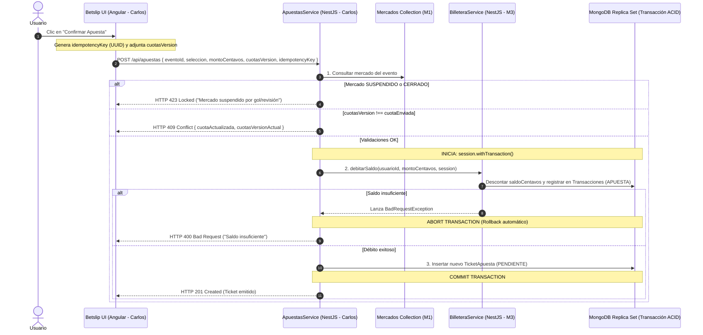

# 📑 Contrato Global e Integración Técnica — NovaBet v2 (Arquitectura Modular)

> **Enfoque de Trabajo:** **Monolito Modular por Vertical Slices (Full-Stack por Feature)**  
> **Stack Oficial:**
> - **Frontend:** Angular 22.0.5 (SSR, Standalone Components, Signals, OnPush)
> - **Backend:** NestJS 11.1.9 (Modular Monolith)
> - **Base de Datos / ODM:** MongoDB con Mongoose 8.20.2 en Replica Set local (`--replSet rs0`) para Transacciones ACID y Change Streams.

---

## 1. Filosofía Arquitectónica y Decisión de Diseño (ADR-001)

El sistema está estructurado como un **Monolito Modular** basado en Vertical Slices. Cada módulo de negocio agrupa su persistencia, lógica de aplicación y presentación:

```
[Módulo 1: Eventos & Mercados]  --> Emite eventos de dominio / Stream SSE
[Módulo 2: Apuestas & Betslip]  --\
                                   +--> Transacción ACID de MongoDB (Límite Transaccional Compartido)
[Módulo 3: Billetera & Ledger]  --/
```

### ⚠️ Trade-Off Crítico Documentado:
* **Decisión:** Para garantizar integridad financiera absoluta (evitar que un usuario apueste sin cobro o pierda dinero ante fallos de servidor), **los Módulos 2 (Apuestas) y 3 (Billetera) comparten una Transacción ACID nativa de MongoDB**.
* **Implicación Arquitectónica:** No nos separamos en microservicios en esta fase. Aceptamos el acoplamiento transaccional en el backend para simplificar el despliegue y eliminar la necesidad de coordinadores de transacciones distribuidas (Sagas / Transactional Outbox). Si en el futuro el sistema migrara a microservicios independientes, este límite requerirá ser reescrito con Sagas asíncronas.

---

## 2. Asignación de Módulos y Flujos de Trabajo

| Módulo | Responsable | Flujo de Negocio Asignado | Rama Git | Issue |
|---|---|---|---|---|
| **Módulo 1** | **Integrante 1** | **Catálogo de Eventos, Mercados In-Play y Simulación:**<br/>Eventos y Mercados en MongoDB, máquina de estados, motor Poisson/Dixon-Coles, Stream SSE de cuotas y Mock de integración rápida. | `feature/modulo-eventos` | `#1` |
| **Módulo 2** | **Integrante 2 (Carlos)** | **Motor de Apuestas & Cupón Reactivo (Betslip):**<br/>Emisión de tickets transaccionales, control de versiones de cuota (`cuotasVersion`), prevención de doble clic (`idempotencyKey`), panel Betslip en Angular. | `feature/modulo-betslip` | `#2` |
| **Módulo 3** | **Integrante 3** | **Billetera Virtual & Libro Mayor (Ledger):**<br/>Gestión de balance en centavos, auditoría inmutable de transacciones (recargas, apuestas, premios, reembolsos), Header y panel de Historial. | `feature/modulo-billetera-usuario` | `#3` |

---

## 3. Modelos Compartidos Oficiales (El Contrato v2)

> **REGLA NO NEGOCIABLE:** Todos los modelos usan **centavos enteros (`int`)** para representar dinero. Queda estrictamente prohibido el uso de flotantes (`float`) en balances y apuestas.

Los modelos del contrato se ubican en `apuestas-web/src/app/domains/`:

### 3.1. Dominio Eventos (`domains/eventos/evento.model.ts`)
```typescript
export type EstadoEvento = 
  | 'PRE-MATCH' 
  | 'LIVE' 
  | 'INTERRUMPIDO' 
  | 'FINALIZADO' 
  | 'EN_REVISION' 
  | 'CANCELADO';

export type ResultadoGanador = 'LOCAL' | 'EMPATE' | 'VISITANTE' | 'SIN_RESULTADO';

export interface Marcador {
  local: number;
  visitante: number;
}

export interface Evento {
  _id: string;
  deporte: string;
  liga: string;
  equipoLocal: string;
  equipoVisitante: string;
  fechaProgramada: string;        // ISO 8601
  inicioReal?: string;            // ISO 8601 (cuando pasa a LIVE)
  estado: EstadoEvento;
  marcador: Marcador;
  resultado: ResultadoGanador;
  createdAt?: string;
  updatedAt?: string;
}
```

### 3.2. Dominio Cuotas & Mercados (`domains/cuotas/mercado.model.ts`)
> **Separación de Colecciones:** Las cuotas ya no viven dentro del `Evento` para evitar colisiones de concurrencia entre el reloj en vivo y las actualizaciones de partidos.

```typescript
export type EstadoMercado = 'ABIERTO' | 'SUSPENDIDO' | 'CERRADO';
export type OpcionSeleccionada = 'LOCAL' | 'EMPATE' | 'VISITANTE';

export interface Cuotas1X2 {
  local: number;     // Decimal redondeado a 2 decimales (ej: 1.85)
  empate: number;    // ej: 3.40
  visitante: number; // ej: 4.20
}

export interface Mercado {
  _id: string;
  eventoId: string;
  tipo: '1X2';
  estadoMercado: EstadoMercado;
  cuotas: Cuotas1X2;
  cuotasVersion: number;          // Contador incremental con cada cambio de cuota
  actualizadoEn: string;
}

// Payload emitido por Server-Sent Events (SSE) hacia Angular:
export interface MercadoActualizadoStream {
  eventoId: string;
  estadoMercado: EstadoMercado;
  cuotas: Cuotas1X2;
  cuotasVersion: number;
  minutoSimulado: number;
  marcador: Marcador;
  emitidoEn: string;
}
```

### 3.3. Dominio Apuestas (`domains/apuestas/apuesta.model.ts`)
```typescript
export type EstadoTicket = 'PENDIENTE' | 'GANADA' | 'PERDIDA' | 'ANULADA';

export interface TicketApuesta {
  _id: string;
  usuarioId: string;              // 'usr-demo'
  eventoId: string;
  eventoResumen: {
    partido: string;
    liga: string;
  };
  seleccion: OpcionSeleccionada;
  cuotaJugada: number;
  cuotasVersion: number;          // Versión congelada en el momento de la apuesta
  montoCentavos: number;          // Ej: 1000 = $10.00 USD
  gananciaPotencialCentavos: number; // Ej: 1850 = $18.50 USD
  estado: EstadoTicket;
  idempotencyKey: string;         // Clave anti-duplicados del frontend
  createdAt: string;              // ISO 8601 nativo
  resueltoEn?: string;
}
```

### 3.4. Dominio Billetera & Ledger (`domains/billetera/billetera.model.ts`)
```typescript
export type TipoTransaccion = 'RECARGA' | 'APUESTA' | 'PREMIO' | 'REEMBOLSO' | 'CLAWBACK';

export interface Billetera {
  _id: string;
  usuarioId: string;              // 'usr-demo'
  saldoCentavos: number;          // Saldo disponible (ej: 100000 = $1,000.00 USD)
  bloqueada: boolean;             // true si saldo negativo por clawback
}

export interface TransaccionLedger {
  _id: string;
  usuarioId: string;
  tipo: TipoTransaccion;
  montoCentavos: number;          // Positivo para ingresos, negativo para egresos
  ticketId?: string;
  eventoId?: string;
  referenciaIdempotente: string;  // Única para auditoría
  createdAt: string;
}
```

---

## 4. Matriz de Endpoints REST y Stream del Backend

Prefijo global: `/api`

| Verbo | Endpoint | Módulo | Descripción | Respuestas Clave |
|---|---|---|---|---|
| `GET` | `/api/eventos` | M1 | Lista eventos activos ordenados por fecha | `200 OK` |
| `PATCH` | `/api/eventos/:id/resultado` | M1 | Actualiza resultado y dispara liquidación | `200 OK`, `409 Conflict` (si ya finalizado) |
| `GET` | `/api/cuotas/stream` | M1 | Server-Sent Events (SSE) con cuotas en vivo | `text/event-stream` |
| `POST` | `/api/apuestas` | M2 (Carlos) | Emite ticket y debita saldo en transacción ACID | `201 Created`, `400 Bad Request` (saldo insuficiente), `409 Conflict` (cuota obsoleta), `423 Locked` (mercado suspendido) |
| `GET` | `/api/apuestas/historial` | M2 (Carlos) | Retorna tickets del usuario ordenados por fecha desc. | `200 OK` |
| `GET` | `/api/billetera/balance` | M3 | Retorna el saldo actual en centavos | `200 OK` |
| `POST` | `/api/billetera/recargar` | M3 | Añade centavos virtuales al usuario | `200 OK` |

---

## 5. El Flujo de Emisión Transaccional (Integración M2 + M3)

Este es el flujo exacto que el Integrante 2 (Carlos) y el Integrante 3 implementan juntos:



---

## 6. Manejo de Errores e Idempotencia en la UI de Angular

1. **Anti Doble Clic:** Al pulsar "Confirmar Apuesta", el frontend deshabilita el botón inmediatamente y envía un `idempotencyKey` generado localmente (`crypto.randomUUID()`). Si la red reintenta la petición, el backend devuelve el ticket existente sin volver a debitar.
2. **Cuota Cambiada (HTTP 409 Conflict):** El Betslip muestra un diálogo/banner de advertencia: *"La cuota ha cambiado de X.XX a Y.YY. ¿Deseas aceptar el cambio y continuar?"*. Si el usuario acepta, actualiza la `cuotasVersion` y reenvía.
3. **Mercado Suspendido (HTTP 423 Locked):** El Betslip bloquea la confirmación con un banner ámbar: *"Mercado suspendido temporalmente por incidente en el partido"*.
4. **Formateo de Moneda:** Toda cifra de dinero en pantallas de Angular se procesa con una función utilitaria o pipe: `montoCentavos / 100` formateado a 2 decimales.
